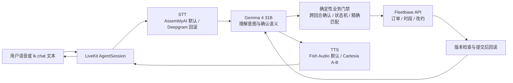
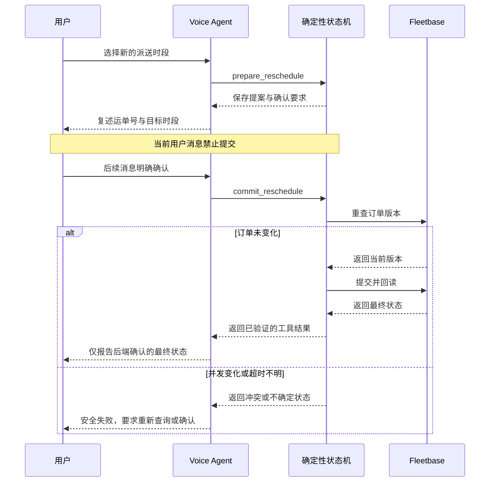

# 中文物流实时语音 Agent

[](https://github.com/zlf137/logistics-customer-service-agent/actions/workflows/ci.yml)
[](LICENSE)

面向真实物流查询与改约流程的中文实时语音 Agent。项目重点不是让模型“尽量猜对”，而是把概率性的 STT 与 LLM 约束在可验证的状态机、精确匹配、并发检查和后端回读中，使识别错误最多退化为安全失败，不能演变成查错订单或误改约。

`Python 3.12` · `LiveKit Agents` · `LLM Function Calling` · `Fleetbase` · `pytest` · `GitHub Actions`

> 当前状态：核心流程已在本地/self-hosted 环境完成自动化、模拟、后端 smoke 与部分真人麦克风验证；**尚未部署 LiveKit Cloud Agent**，云端目前也不能访问本机 Fleetbase。不要将本项目描述为已上线生产。

## 核心工程亮点

- 运单查询采用“捕获候选 → 逐字符复述 → 后续用户消息确认 → 精确查询”，同一用户消息不能直接触发查询。
- 改约采用“准备 → 后续独立确认 → 提交”，提交前重查订单版本，提交后回读，覆盖并发冲突和幂等成功。
- 支持全角折叠、空格/连字符清理、纯中文逐位数字以及“ASCII 字母 + 中文逐位数字”的确定性规范化；拒绝中文单位数词与模糊匹配。
- 根据 STT provider 选择原生 EOT 或 LiveKit Turn Detector，并保留 AssemblyAI/Deepgram、Fish Audio/Cartesia 的环境变量 A/B 与回滚路径。
- 使用单元测试、文本 debugger、音频 simulation、只读 Fleetbase smoke 和真人 Console 分层验证，不把“已实现”当作“已验证”。

## 演示与复盘

- [两分钟演示脚本与镜头表](docs/DEMO_SCRIPT_ZH.md)：使用合成数据演示查询、跨回合确认、失败安全和语音打断，并明确写入前的授权边界。
- [中文工程复盘](docs/PROJECT_CASE_STUDY_ZH.md)：故障根因、设计取舍、验证证据、简历摘要与面试问答。

## 架构



高风险写入不由 prompt 单独决定：



## 验证快照

| 层级 | 最近证据 | 边界 |
| --- | --- | --- |
| 本地回归 | 47/47、Ruff lint/format、YAML/内部链接与 `git diff --check` 通过（2026-11-15） | 确定性逻辑、配置与作品集文档 |
| 文本 debugger | 混合口述运单先复述，后续确认才精确查询 | 不经过 STT/TTS |
| LiveKit simulation | 文本 5/5、音频 1/1 曾通过 | 使用合成数据和云端推理 |
| Fleetbase smoke | 订单命中并返回 3 个时段；默认只读 | 最近一次未提交改约 |
| 真人 Console | 8 位纯数字流程通过；明确打断约 0.55 秒生效 | 混合运单、backchannel 与背景噪声仍待完整 A/B |

这些数字是特定版本和小样本证据，不代表通用模型准确率。以当前 checkout 重新运行验证为准。

## 快速开始

需要 Python 3.10–3.14、[uv](https://docs.astral.sh/uv/) 和 [LiveKit CLI](https://docs.livekit.io/reference/developer-tools/livekit-cli/)。

```console
git clone https://github.com/zlf137/logistics-customer-service-agent.git
cd logistics-customer-service-agent
uv sync --locked --dev
```

复制 `.env.example` 为本地 `.env.local`，填入自己的开发凭据；不要提交或公开任何 `.env*`。本机 Fleetbase 连接另行使用未版本化的 `.env.fleetbase.local`。

仓库中的 [`AGENTS.md`](AGENTS.md) 记录 LiveKit 文档、调试、simulation 与交接要求。涉及 LiveKit API 时先查阅当前官方文档；修改核心会话行为时先补 scenario，再使用 debugger 和分层验证证明结果。

## 运行与验证

本地真实语音 Console：

```console
lk agent console
```

连接 LiveKit Cloud 的本地开发 worker。它不会创建 Cloud 部署：

```console
lk agent dev
```

文本逐回合调试：

```console
lk agent debugger start
lk agent debugger say "你好，我想查询运单状态。"
lk agent debugger stop
```

确定性检查无需云端凭据：

```console
uv run ruff check .
uv run ruff format --check .
uv run python -m pytest
```

需要真实推理额度的模拟只在本地显式执行，GitHub `Simulations` workflow 也仅支持手动触发：

```console
lk agent simulate text --scenarios scenarios.yaml --concurrency 1 --yes
lk agent simulate audio --scenarios scenarios.audio.yaml --concurrency 1 --yes
```

模拟文件只使用合成数据，不要替换成客户数据。

直接运行 worker：

```console
uv run src/agent.py start
```

## Chinese STT configuration

Mandarin is transcribed through LiveKit Inference with **AssemblyAI
Universal-3.6 Pro** (`assemblyai/universal-3-6-pro`) and its accuracy profile.
`src/agent.py` builds the STT call from one pure function,
`stt_inference_kwargs()`; provider-specific options are gated by model prefix,
so AssemblyAI options are never sent to Deepgram and vice versa. Deepgram Nova-3
stays available as an env-only rollback/A-B option.

### Default: AssemblyAI Universal-3.6 Pro

The language switches to `zh` automatically, because that is AssemblyAI's code
for Mandarin. With the default `accuracy` profile it sends these
AssemblyAI-only options:

| Option | Value | Why |
|--------|-------|-----|
| `mode` | `max_accuracy` | Accuracy preset for Chinese contact-centre speech. |
| `prompt` | short Chinese logistics prompt | Domain context: waybill numbers, parcel status, delivery slots, rescheduling, and Latin letters or digits spoken one character at a time. |
| `keyterms_prompt` | same list as `STT_KEYTERMS` | One source of truth; the Inference SDK also merges `STTContextOptions.keyterms` into the same field. |
| `min_turn_silence` | 500 ms | A short mid-sentence pause, for example while spelling a waybill number, does not end the turn. |
| `max_turn_silence` | 1500 ms | Gives slowly dictated waybills room for short pauses without imposing a three-second forced-finalisation wait. |
| `continuous_partials` | `true` | Publishes interim hypotheses as they are revised, so the console or frontend shows partial text while the user is still speaking. |
| `interruption_delay` | 250 ms | Documented 0–1000 ms knob that allows an earlier first partial. 250 ms is a conservative start, not a tuned value. |

`voice_focus` is intentionally not set: RoomIO already applies AI acoustics
enhancement, and the microphone type is unknown. The two turn-silence values are
conservative starting points for A/B testing, not tuned values.

**Observed A/B evidence (2026-11-12):** on the same synthesized 8-digit waybill
samples, AssemblyAI produced a complete transcription for 3/3 samples and
Deepgram Nova-3 for 2/3. One AssemblyAI sample arrived in two transcript
segments, but the segments were combined correctly before the Fleetbase lookup,
so the split did not cause a miss. This is a small, synthesized run, not a
statistical proof; it is the reason the accuracy profile is the default again,
with Deepgram kept as a rollback for further comparison.

AssemblyAI notes: the installed `livekit-agents` 1.8.10 type hints mark `prompt`
as mutually exclusive with `keyterms_prompt`, while current Inference docs list
both. If a live session reports a gateway error for the combination, drop
`prompt` from `assemblyai_extra_kwargs` and keep `keyterms_prompt`.

The same 1.8.10 type stubs do not list `min_turn_silence`, `continuous_partials`
or `interruption_delay`; `extra_kwargs` is forwarded to the gateway as a plain
dict, so acceptance is decided server-side. If a live session fails at start with
an unknown-option error, remove only the rejected key(s) from
`assemblyai_extra_kwargs` and restart — the other accuracy options are
independent.

### Turn handling follows the STT provider

`src/agent.py` builds `TurnHandlingOptions` from one testable helper,
`turn_handling_options()`, which switches on the configured STT model:

| STT model | `turn_detection` | `endpointing.min_delay` | Why |
|-----------|------------------|-------------------------|-----|
| AssemblyAI Universal-3.6 Pro (default) | `"stt"` | `0` seconds | AssemblyAI already emits its own end-of-turn signal from the transcript it returns. STT turn detection lets that signal commit the turn, and a zero minimum delay stops LiveKit from adding a second wait on top of the provider's endpointing. |
| Deepgram Nova-3 rollback and other providers | `inference.TurnDetector()` | Session default (0.3 s for the streaming detector) | Preserves the previous LiveKit turn-detector behavior exactly. |

With `turn_detection="stt"`, LiveKit does not run the turn-detector model; it
commits the user turn when the STT reports `END_OF_SPEECH`. The AssemblyAI
`min_turn_silence` (500 ms) and `max_turn_silence` (1500 ms) options are
unchanged: they still decide when the provider finalises a transcript and emits
that end-of-turn event. Note the units differ — `endpointing.min_delay` is in
seconds, while the AssemblyAI silence options are in milliseconds.

Text simulations commit turns as text, so this setting only affects audio
sessions.

Unit tests pin the provider-to-mode selection. In a local audio-debugger A/B
with the same three synthesized, deliberately paused 8-digit waybill turns,
both configurations transcribed 3/3 completely. Provider-aware handling removed
the LiveKit EOT prediction and 2.5-second dynamic endpointing path, emitted no
late-transcript warning, and reduced observed end-to-end latency from roughly
3.05–4.50 seconds to 2.03–2.62 seconds. This is synthetic evidence; a real
microphone remains the final acceptance test.

### Interruption handling

Interruption handling is a separate concern from the user-end detection above:
it decides whether the agent yields the floor while it is speaking. `src/agent.py`
pins it through `interruption_options()` for every STT provider:

| Option | Value | Why |
|--------|-------|-----|
| `mode` | `"adaptive"` | Uses the acoustic interruption detector instead of plain VAD when the detector service is available, so it can distinguish short backchannels such as "嗯" or "好" from a real barge-in. Without this explicit mode the local/self-hosted Console falls back to VAD. |
| `min_duration` | `0.5` s | Speech shorter than this is not treated as an interruption. |
| `min_words` | `0` | No additional word-count gate for a short barge-in. |
| `resume_false_interruption` | `true` | Continues the interrupted reply when the overlap is classified as false. |
| `false_interruption_timeout` | `2.0` s | Silence after an interruption before it is classified as false. |
| `backchannel_boundary` | `(1.0, 1.0)` | Suppresses backchannel-classified overlap near the start and end of each agent turn. |

Preemptive generation stays enabled (`preemptive_generation={"enabled": True}`),
unchanged by this work. The adaptive detector is covered by the local dev
allowance on LiveKit Cloud; self-hosted use past the monthly allowance is
billed. If the SDK cannot create the detector it logs a warning and falls back
to VAD, so the session still starts.

Unit tests pin these values and the separation from provider-aware turn
detection. In the 2026-11-13 real-microphone run, the detector initialized
without VAD fallback and classified “你别说了” as a real interruption after
about 0.55 seconds (about 0.86 probability); the active reply was marked
`interrupted`. In a separate 2026-11-15 run, the detector created its session
but then returned a 0.8-second inference timeout (HTTP 408), so the SDK disabled
it and fell back to plain VAD. After that fallback, a filler “哎” interrupted
the waybill read-back. This is availability/fallback evidence, not a successful
backchannel-suppression result. Background-noise and false-resume A/B remain
open, and the AssemblyAI `min_turn_silence`/`max_turn_silence` values were
deliberately not changed in this round.

### Rollback / A-B: Deepgram Nova-3

`LOGISTICS_STT_MODEL=deepgram/nova-3-general` switches to the mainstream LiveKit
voice-agent path: it streams interim and final results, supports `zh-CN`, and
needs no extra plugin or API key through Inference. The language switches to
`zh-CN` automatically.

| Option | Value | Why |
|--------|-------|-----|
| `language` | `zh-CN` | BCP-47 Mandarin locale for Nova-3. |
| `interim_results` | `true` | Streams interim hypotheses so the console or frontend shows text while the user is still speaking. |
| `no_delay` | `false` | Lets Smart Format wait for a spoken number to finish; Deepgram warns that forcing immediate finalization can skip entity formatting. |
| `smart_format` | `true` | Formats dates, times, numbers and similar entities for readability. |
| `numerals` | `true` | Renders spoken numbers as digits, which matters for waybill digits. |
| `punctuate` | `true` | Adds punctuation to transcripts. |
| `endpointing` | 800 ms | Silence before a final. Interim text still streams immediately, while the longer finalisation window avoids splitting slowly dictated waybill digits into separate tool calls. |
| `keyterm` | same list as `STT_KEYTERMS` | Biases logistics terms and the example waybill; the Inference SDK merges `STTContextOptions.keyterms` into the same field. |

Every provider option above except `language` exists in the installed
`livekit-agents` 1.8.10 `DeepgramOptions` type (`language` is an `inference.STT`
argument), so this profile carries no unknown-option risk. The model ID and
`zh-CN` support were checked against current LiveKit docs; the same 1.8.10 model
literal still lists only `deepgram/nova-3`. If the gateway rejects the model ID
at session start, set `LOGISTICS_STT_MODEL=deepgram/nova-3` — no code edit
needed.

These options change how transcripts are surfaced, not how LiveKit Inference
retries a provider WebSocket. A reset or retry still costs the reconnect time
and any audio the provider did not accept, so a single slow turn (the observed
11.2 s case) is not fixed by partial transcripts.

`LOGISTICS_STT_PROFILE=baseline` sends no provider extras at all: whichever
model is selected falls back to its provider's own defaults. It does not change
the model or the language.

### A/B without code edits

Everything below is read when the process starts, so restart the agent after
changing a variable. Windows PowerShell:

```powershell
# Default: AssemblyAI Universal-3.6 Pro with the accuracy profile above.
lk agent console

# Rollback / A-B to Deepgram Nova-3; no code edit.
$env:LOGISTICS_STT_MODEL = "deepgram/nova-3-general"
lk agent console

# Back to the default AssemblyAI model.
Remove-Item Env:\LOGISTICS_STT_MODEL
lk agent console

# Provider defaults for whichever model is selected (no extra_kwargs).
$env:LOGISTICS_STT_PROFILE = "baseline"
lk agent console
Remove-Item Env:\LOGISTICS_STT_PROFILE

# Let LiveKit choose the provider for Chinese; no provider extras are sent.
$env:LOGISTICS_STT_MODEL = "auto:zh"
lk agent console
```

A value set in `.env.local` also applies; `load_dotenv` does not override a
variable already set in the process environment, so a shell value wins.

### How to compare

Record one fixed set of 5–10 real-microphone utterances per model, including a
waybill number read digit by digit, a delivery-slot question, and a rescheduling
request. Run the same recordings against AssemblyAI and the Deepgram rollback,
then compare the Agent Console transcripts and note missed words, wrong digits
and premature fragments. **The 2026-11-12 result above comes from a small
synthesized sample and does not prove real-microphone accuracy**; keep using the
Deepgram rollback until a longer real-speaker comparison confirms the default.

## TTS configuration and rollback

The default voice pipeline uses **Fish Audio S2.1 Pro**
(`fishaudio/s2.1-pro`) through LiveKit Inference with `language="zh"` and the
male voice `fa4c9eb3dccc4806b382b40d61c6b10a`. Cartesia Sonic 3, 3.5 and 3.6
remain available as env-only A/B options. Voices and reliability settings are
provider-specific rather than shared across the models.

`src/agent.py` builds the TTS call from one pure function,
`tts_inference_kwargs()`; provider-specific extras are gated by model prefix, so
Cartesia options are never sent to Fish Audio and vice versa. The voice is also
provider-aware (`resolve_tts_voice()`): it follows the selected model, and
`LOGISTICS_TTS_VOICE` overrides it for either provider.

### Default: Fish Audio S2.1 Pro

| Option | Value | Why |
|--------|-------|-----|
| `language` | `zh` | Mandarin synthesis. |
| `voice` | `fa4c9eb3dccc4806b382b40d61c6b10a` | Male voice selected in the live A/B. |
| `latency` | `balanced` | Avoids the quality trade-off of low-latency mode. |
| `temperature` / `top_p` | 0.6 / 0.7 | Reduces variation between repeated utterances. |
| `normalize` / `normalize_loudness` | `true` / `true` | Normalises spoken forms and output loudness. |
| `speed` | 1.0 | Natural speaking rate. |

`emotion` and the timestamp options are deliberately not sent: expressive
markup stays off, and the model must not be encouraged to emit emotion tags.
All three keys exist in the installed `livekit-agents` 1.8.10 `CartesiaOptions`
type, and `cartesia/sonic-3.5` is in the installed 1.8.10 `inference.TTS` model
literal (as are `cartesia/sonic-3` and `cartesia/sonic-3-latest`), so the
default carries no unknown-model or unknown-option risk. `cartesia/sonic-3.6`
is **not** in that literal; it comes from current LiveKit docs and is kept as
an env-only A/B option. If the gateway rejects it at session start, remove
`LOGISTICS_TTS_MODEL` to return to the default, or use `cartesia/sonic-3` or
`cartesia/sonic-3.5`, both of which are in the literal — no code edit is
needed either way.

**Observed live evidence (2026-11-12):** in separate local runs, Sonic 3.5 was
the only Cartesia model that completed normally across consecutive turns — it
returned to listening and produced complete Chinese assistant speech with
observed TTS time-to-first-byte around 0.43–1.02 seconds. Its protective `flush
audio emitter due to slow audio generation` lines varied from one to many
without truncating those turns. Sonic 3 had a lower TTFB but stayed stuck in the
speaking state beyond 30 seconds and emitted no final assistant conversation
item in that run. These are single-run observations under the same local
conditions, not a statistical comparison or a real-speaker A/B; they are the
reason for choosing Sonic 3.5 as the default, not proof that it is generally
more reliable.

### What the `flush audio emitter` line means

`flush audio emitter due to slow audio generation` is a **debug-level** log
line from the LiveKit TTS emitter. When synthesis falls behind real-time
playback, the emitter releases the audio it has already buffered so the
downstream player does not underrun and stutter. It is a protective buffer
release, not an API error, and no server-side fallback triggers on it: it does
not cause LiveKit Inference or the gateway to switch models. Repeated
occurrences are the symptom to watch, because they mean generation is
consistently slower than playback; a single occurrence on one reply is not by
itself a failure.

### A/B: Cartesia

Set `LOGISTICS_TTS_MODEL` to `cartesia/sonic-3`, `cartesia/sonic-3.5`, or
`cartesia/sonic-3.6` to compare Cartesia. The provider-aware resolver selects
Cartesia's voice and its speed, volume and buffer options automatically.

| Option | Value | Why |
|--------|-------|-----|
| `language` | `zh` | Mandarin for Sonic's multilingual mode. |
| `voice` | `f786b574-daa5-4673-aa0c-cbe3e8534c02` | Cartesia's official plugin default voice. |
| `speed` | 1.0 | Natural speaking rate. |
| `volume` | 1.0 | Neutral output level. |
| `max_buffer_delay_ms` | 300 ms | A bounded-buffer A/B starting point, not a generally tuned value. |

Cartesia-specific keys are never sent to Fish, and Fish-specific latency,
sampling and normalisation keys are never sent to Cartesia.

`LOGISTICS_TTS_PROFILE=reliability` (default) sends the table for the selected
provider; `LOGISTICS_TTS_PROFILE=baseline` sends only model, voice and
language. It does not change expressive mode; that needs
`LOGISTICS_TTS_EXPRESSIVE` as well. All variables are read at process start, so
restart the agent after changing one.

### A/B and rollback without code edits (PowerShell)

```powershell
# Default: Fish Audio S2.1 Pro with the male voice and settings above.
lk agent console

# A/B the other Cartesia models; voice and extras stay identical.
$env:LOGISTICS_TTS_MODEL = "cartesia/sonic-3"
lk agent console

$env:LOGISTICS_TTS_MODEL = "cartesia/sonic-3.6"
lk agent console

# Back to the Fish Audio default.
Remove-Item Env:\LOGISTICS_TTS_MODEL
lk agent console

# Try a different voice for the selected provider (it must belong to it).
$env:LOGISTICS_TTS_VOICE = "<voice-id>"
lk agent console
Remove-Item Env:\LOGISTICS_TTS_VOICE

# Provider defaults only, for whichever model is selected.
$env:LOGISTICS_TTS_PROFILE = "baseline"
lk agent console
Remove-Item Env:\LOGISTICS_TTS_PROFILE

# Expressive markup back on (Fish Audio) for a same-utterance A/B.
$env:LOGISTICS_TTS_EXPRESSIVE = "1"
lk agent console
Remove-Item Env:\LOGISTICS_TTS_EXPRESSIVE
```

`LOGISTICS_TTS_EXPRESSIVE` accepts `1/true/yes/on` and `0/false/no/off`
(case-insensitive); an unset or unrecognised value stays off, and a typo logs a
warning instead of silently re-enabling markup.

### What is and is not verified

Unit tests pin the configuration plumbing only. The 2026-11-13 real-microphone
A/B established that the selected Fish male voice was much smoother than
Cartesia 3.5 and 3.6 in that session; it does not prove a general provider
advantage. Repeat a fixed 5–10 utterance set, including a digit-by-digit
waybill, before making broader pronunciation or reliability claims. Repeated
`flush audio emitter` lines after a model switch indicate synthesis running
behind playback (provider load or network), not an automatic fallback. The
2026-11-15 live run produced several of these lines with perceptible response
delay, while replies still completed; it is degradation evidence rather than a
failed TTS request.

## Frontends and telephony

### Waybill confirmation and typed input

Every waybill is confirmed before it is looked up. `prepare_waybill_lookup()`
normalizes the number, stores it with the id of the latest committed user
message (the same anchor the reschedule flow uses), and returns a read-back
payload; it never queries Fleetbase. The agent must read the candidate back
digit by digit and ask whether it is correct.
`lookup_waybill()` then refuses to run unless the same normalized candidate was
prepared in an **earlier** user message, so a lookup can never happen in the
turn that supplied the number. Saying the number is wrong, or dictating a new
one, simply prepares again and overwrites the candidate. A lookup clears the
candidate, so retrying always goes through one fresh read-back.
`list_delivery_slots()` is guarded the same way: it reads the order endpoint
internally, so it refuses any number that was not confirmed **and** found by a
successful lookup. Preparing a new number clears that authorization, so one
order can never unlock a slot query for another.

Validation stays exact. `FleetbaseClient.normalize_waybill()` applies NFKC
full-width folding, then strips whitespace and hyphens and uppercases the
result. Chinese digit characters (`零〇○一二三四五六七八九幺`) are converted
one character at a time when the candidate is either all digits or an ASCII
alphanumeric identifier, so `幺二三四五六七八` becomes `12345678` and
`log九一一三一八零四三八sg` becomes `LOG9113180438SG`. Values that mix Chinese
digits with unit words such as `十`, `百`, `千` or `万` are left untouched and
fail the exact match, because a unit reading is ambiguous; there is no fuzzy or
nearest-number matching anywhere in the path. Numbers shorter than eight
characters are rejected as incomplete before any request is made.

Typed input remains available but is only ever a suggestion. LiveKit
`AgentSession` accepts typed messages through the `lk.chat` text stream, and
the official Agent Embed Widget can expose that channel as a chat pane; enable
**Text chat** on the agent's **Embed → Settings** page in LiveKit Cloud. When a
number is incomplete or not found, the agent may offer the chat input as one
option, but it must keep accepting a repeated voice dictation: there is no
failure counter that forces the keyboard.

Official setup: [Agent Embed Widget](https://docs.livekit.io/agents/start/embed/)
and [text input](https://docs.livekit.io/agents/multimodality/text/).

Pair the agent with a prebuilt frontend starter, or add telephony:

| Platform | Link | Description |
|----------|----------|-------------|
| **Web** | [`livekit-examples/agent-starter-react`](https://github.com/livekit-examples/agent-starter-react) | Web voice AI assistant with React & Next.js |
| **iOS/macOS** | [`livekit-examples/agent-starter-swift`](https://github.com/livekit-examples/agent-starter-swift) | Native iOS, macOS, and visionOS voice AI assistant |
| **Flutter** | [`livekit-examples/agent-starter-flutter`](https://github.com/livekit-examples/agent-starter-flutter) | Cross-platform voice AI assistant app |
| **React Native** | [`livekit-examples/voice-assistant-react-native`](https://github.com/livekit-examples/voice-assistant-react-native) | Native mobile app with React Native & Expo |
| **Android** | [`livekit-examples/agent-starter-android`](https://github.com/livekit-examples/agent-starter-android) | Native Android app with Kotlin & Jetpack Compose |
| **Web Embed** | [`livekit-examples/agent-starter-embed`](https://github.com/livekit-examples/agent-starter-embed) | Voice AI widget for any website |
| **Telephony** | [Documentation](https://docs.livekit.io/telephony/) | Add inbound or outbound calling to your agent |

For more options, see the [frontend guide](https://docs.livekit.io/frontends/).

## Testing and debugging

Simulations run full multi-turn conversations between a simulated user and your agent on LiveKit Cloud, then judge each transcript. The scenarios live in [`scenarios.yaml`](scenarios.yaml). Run them locally with the CLI:

```console
lk agent simulate text --scenarios scenarios.yaml
```

The `Simulations` workflow in [`.github/workflows/simulations.yml`](.github/workflows/simulations.yml) is manual-only because it needs repository secrets and spends real inference credits. The keyless [CI workflow](.github/workflows/ci.yml) runs Ruff lint, Ruff format checking, and pytest on every push and pull request. See the [simulations guide](https://docs.livekit.io/testing/simulations/) for how to write scenarios and read results.

To check a change turn by turn without a live session, use the [agent debugger](https://docs.livekit.io/testing/debugger/) shown in [运行与验证](#运行与验证).

To debug a running agent, open it in the [Agent Console](https://docs.livekit.io/testing/agent-console/). It shows events, tool calls, and model timing as you talk to the agent. To stream logs from a deployed agent, run `lk agent logs`.

## 上游来源与许可

本项目从 LiveKit 官方 [`agent-starter-python`](https://github.com/livekit-examples/agent-starter-python) 改造而来，保留其 MIT License 与上游参考；作品仓库使用独立的包名、Agent 名称、业务状态和验证材料。`upstream` 用于对照 SDK 推荐实践，不是本项目的发布或更新源。

`uv.lock` 已纳入版本控制以保证可复现安装。只有需要手动运行云端 simulation 时，才在 GitHub repository secrets 中配置 `LIVEKIT_URL`、`LIVEKIT_API_KEY` 和 `LIVEKIT_API_SECRET`；不要把值写入仓库。

## 部署边界

仓库包含可用于 LiveKit Cloud 或其他环境的 `Dockerfile`，但当前项目尚未完成 Cloud Agent 部署，且本机 Fleetbase 对云容器不可达。准备公开演示前必须先解决后端可达性、演示数据隔离和凭据管理，再按[部署指南](https://docs.livekit.io/deploy/agents/)验收。

## Self-hosted LiveKit

You can self-host LiveKit instead of using LiveKit Cloud. See the [self-hosting guide](https://docs.livekit.io/transport/self-hosting/local/). If you self-host, use [model plugins](https://docs.livekit.io/agents/models/#plugins) instead of LiveKit Inference, and remove the [LiveKit Cloud noise cancellation](https://docs.livekit.io/transport/media/noise-cancellation/) plugin.

## License

This project is licensed under the MIT License. See [LICENSE](LICENSE) for details.
